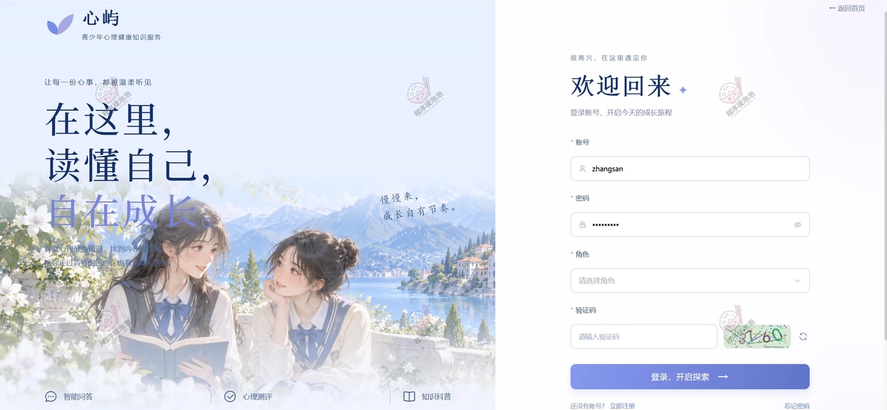
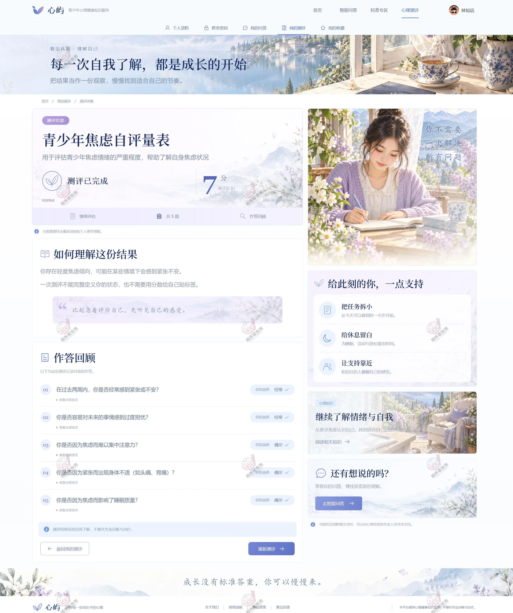
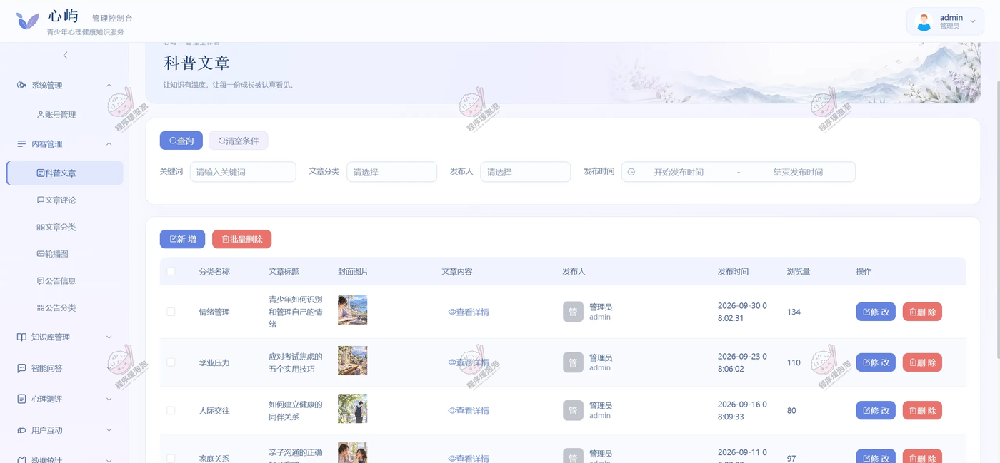
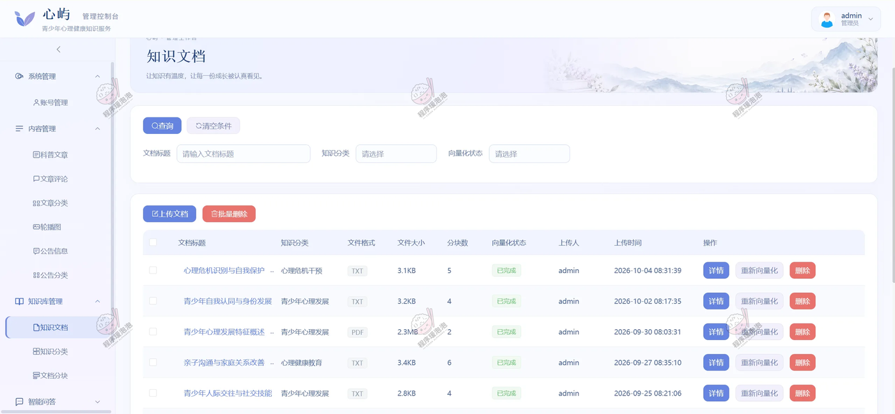
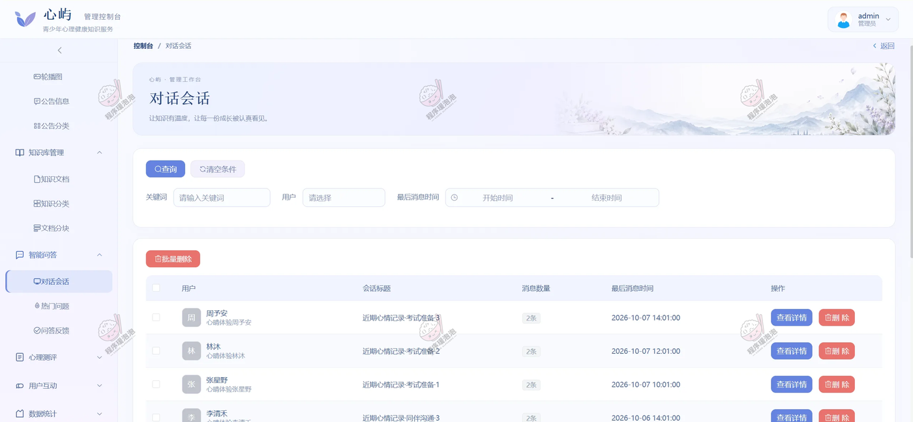
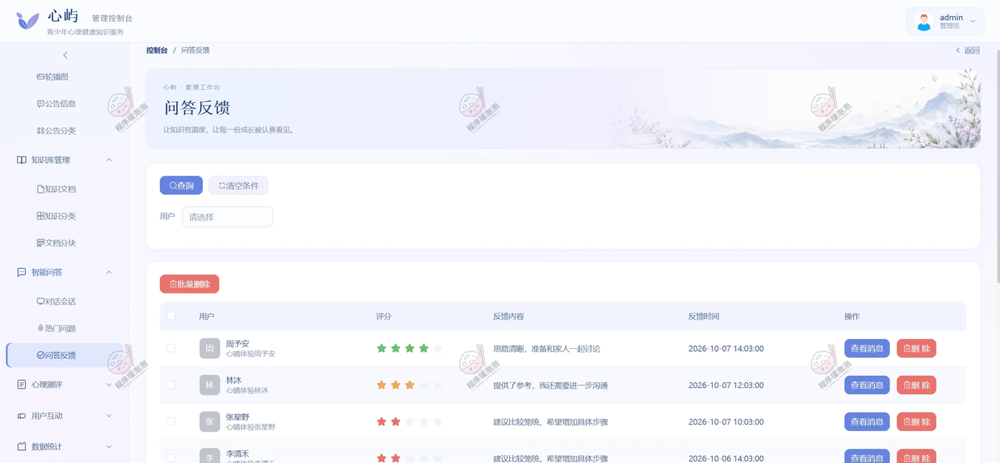
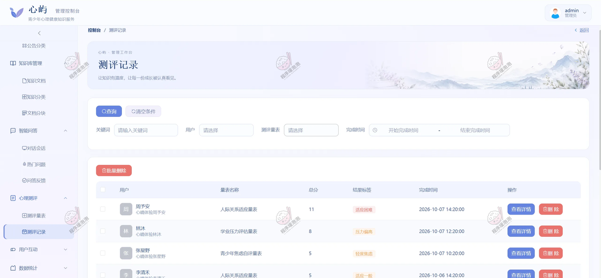
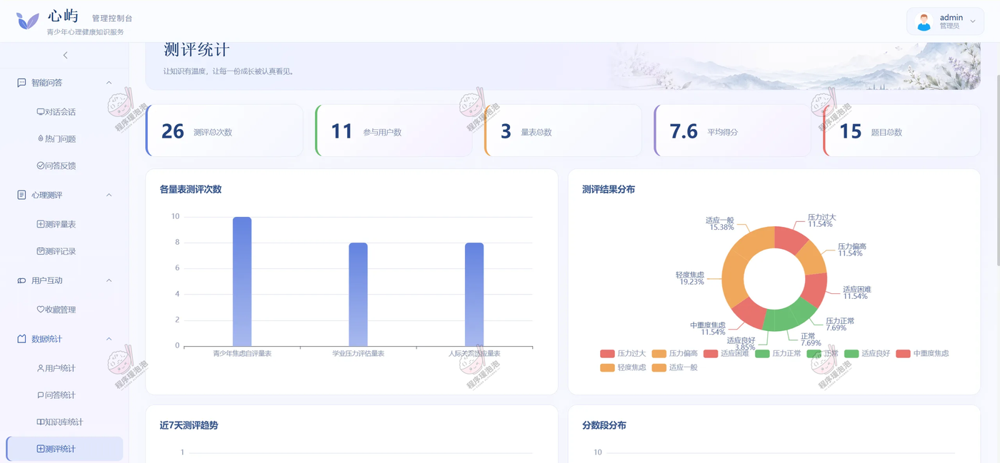

# QaMentalHealthKnowledgeServicesAdolescents
基于RAG的青少年心理健康知识服务型问答系统 亮点：AI问答、RAG知识问答、  ECharts可视化、知识内容维护、心理测评闭环；

所有源码均本人开发，项目是前后端分离的，所有的项目都具备了完整的业务逻辑，不仅仅局限于基础的增删改查（CRUD）操作，系统亮点众多。

本文注重于计算机毕业设计选题指导，列出题目均有源码， 大家可以去【公众号】(毕业终点站)获取或者加我【qq】(2112698948)提意见(别忘记Star哟)。备注：git

声明：仅用于学习使用，请勿用于任何商业行为！

1.系统非商用，非开源，非无偿。

2.由本人开发，如需源码，请联系以下方式，qq:2112698948。

3.项目有很多，并未全部上传，如果未找到想要的，可直接咨询。

# 心屿 · 青少年心理健康知识服务问答系统

> 面向青少年与家长的心理健康知识服务 Web 系统：把心理科普文档整理成可检索的知识库，用 RAG 结合 DeepSeek 回答问题，再配上心理测评与科普阅读。普通用户在网页端提问、测评、读文章，管理员在后台上传文档、维护量表、看问答与测评数据。

## 一、系统亮点

**1. RAG 知识问答，回答有据可查**
知识文档先经 Apache Tika 解析、按语义分块，再用中文 Embedding 向量化写入 PGVector。用户提问时先检索相关片段，再交给 DeepSeek 组织语言，回答下方附上引用的知识片段与所属文档，能直接看到这句话是从哪篇资料里来的。

**2. AI 问答体验完整**
回复通过 SSE 流式输出，逐字显示不用干等；支持连续追问、历史会话切换与删除。每条回答可以打星、写反馈，管理端能翻会话记录和满意度情况，回答得不好能追溯到具体知识点。

**3. ECharts 数据看板**
测评统计页给出测评总次数、参与用户数、量表总数、平均得分、题目总数五个指标，配各量表测评次数柱状图、测评结果分布环图、近 7 天测评趋势和分数段分布；侧栏另分用户统计、问答统计、知识库统计，趋势、分布和中文词云各有对应图表。

**4. 心理测评全流程**
量表、题目、选项分值、评分规则都在后台统一维护。用户选量表、逐题作答，提交后按规则自动计分并给出结果解读，个人中心保留每一次测评记录，可以回看当时的作答。

**5. 知识内容维护**
文档上传后能一键生成 AI 摘要与信息解析，查看分块数与向量化状态，资料更新时可重新向量化，不用重建整个库；科普文章用 AiEditor 在线编辑发布，带分类、封面、评论与收藏记录。

## 二、技术选型

| 层次 | 技术 |
| --- | --- |
| 架构 | B/S、MVC、前后端分离（普通用户网页端 + 管理后台） |
| 开发环境 | Windows、IDEA、JDK 17、Maven、MySQL、PostgreSQL、Node.js |
| 后端 | Java、Spring Boot 3、Spring MVC、MyBatis-Plus、JWT、LangChain4j、Apache Tika、HanLP |
| 前端 | Vue 3、Vite、Element Plus、Vue Router、Pinia、Axios、ECharts、AiEditor |
| AI 与存储 | DeepSeek、中文 Embedding、RAG 检索增强生成、PGVector 向量存储、MySQL 业务数据、SSE 流式回复 |

## 三、角色与功能

| 角色 | 主要功能 |
| --- | --- |
| 普通用户 | 注册登录与找回密码；首页公告、搜索与热门问题；AI 智能问答（新建会话、连续追问、流式回复、历史会话）；知识溯源与回答评分反馈；心理测评（选量表、在线答题、自动计分、结果解读、历史记录）；科普阅读（列表、详情、评论、收藏）；个人中心（资料、密码、我的问答 / 测评 / 收藏） |
| 管理员 | 用户管理（查询、新增编辑、删除、重置密码）；知识库管理（分类、文档上传、AI 摘要与解析、文本分块、向量化状态、重新向量化）；问答管理（会话记录、对话消息、热门问题、评分与反馈）；心理测评管理（量表、题目、选项分值、评分规则、测评记录）；科普内容管理（文章分类、发布、评论与收藏记录）；系统维护（公告分类、公告、轮播图、个人资料与密码）；统计分析（用户、问答、知识库、测评四类） |

## 四、系统截图

> 源文档共 15 张截图，这里展示 14 张核心页面（登录 1 + 普通用户端 7 + 管理员端 6）；文章评论管理页未单独列出，功能已在上方角色表中覆盖。

### 登录入口

**登录页**：左侧是品牌插画和「读懂自己，自在成长」，右侧填写账号、密码、选择角色并输入验证码；普通用户与管理员从同一个入口按角色进入各自的工作台。

### 普通用户端

**首页**：顶部导航分首页、智能问答、科普专区、心理测评和我的收藏。首屏是搜索框与「开始提问」，下面按情绪与压力、学习与成长、人际与沟通、自我与认知四类组织内容，再往下是精选科普文章和「一个问题，也可以是改变的开始」三步说明。

**智能问答 · 新建会话**：左侧是新建对话、对话记录与热门问题，中间是问候语和学习压力 / 人际沟通 / 情绪调节三个快捷话题，右侧「也许你想了解」按当前话题推荐文章。实际对话中回复按 SSE 逐字显示，并附知识片段作为依据。

<table>
<tr>
<td width="50%"></td>
<td width="50%"></td>
</tr>
<tr>
<td><strong>科普专区</strong> 按情绪管理、学业压力、人际交往、家庭关系、自我成长分类，支持最新发布 / 推荐阅读切换和关键词搜索，文章卡片带封面、标签和摘要。</td>
<td><strong>科普文章详情</strong> 正文分节并生成右侧目录，底部可以收藏、写留言；右侧「猜你想读」推相关文章，读完能直接跳去智能问答继续追问。</td>
</tr>
</table>

<table>
<tr>
<td width="50%"></td>
<td width="50%"></td>
</tr>
<tr>
<td><strong>心理测评 · 量表列表</strong> 学业压力、青少年焦虑、人际关系三张量表，标着适用人群和题量（各 5 题），上方是选择测评、按真实感受作答、查看结果三步说明。</td>
<td><strong>在线测评 · 逐题作答</strong> 顶部显示第几题 / 共几题和进度点，题干下面四个选项单选，可以回看上一题，右侧是作答提醒。</td>
</tr>
</table>

**测评结果**：提交后给出总分和结果标签（示例为 7 分、轻焦虑），「如何理解这份结果」给一段解读，下面逐题回看作答；右侧按结果给出三条可执行的小建议，也能继续去智能问答聊聊。

### 管理员端

**科普文章**：列表带分类、标题、封面、发布人、发布时间和浏览量，支持按关键词 / 分类 / 发布人 / 时间筛选，新增与修改都在弹出页里完成。

**知识文档**：RAG 的知识来源都在这里。每份文档显示格式、大小、分块数和向量化状态（已完成 / 处理中），可查看详情、重新向量化或删除；上传后由 Tika 解析、按块切分再写入向量库。

**对话会话**：按用户和最后消息时间筛选，列表显示会话标题、消息条数和最后活跃时间，点开能看完整对话，也可以批量清理。

**问答反馈**：每条回答的星级评分和用户留言集中在这里，可按用户筛选，方便定位回答质量不高的知识点。

**测评记录**：按用户、量表、完成时间筛选，列表给出总分和结果标签（适应良好 / 压力偏高 / 轻度焦虑 / 适应困难等），点开可以看逐题作答。

**测评统计**：顶部五张指标卡（测评总次数、参与用户数、量表总数、平均得分、题目总数），下面配各量表测评次数柱状图、测评结果分布环图、近 7 天测评趋势和分数段分布；侧栏另有用户统计、问答统计与知识库统计。

---

文档展示 14 张截图，需要了解更多，请联系我。
